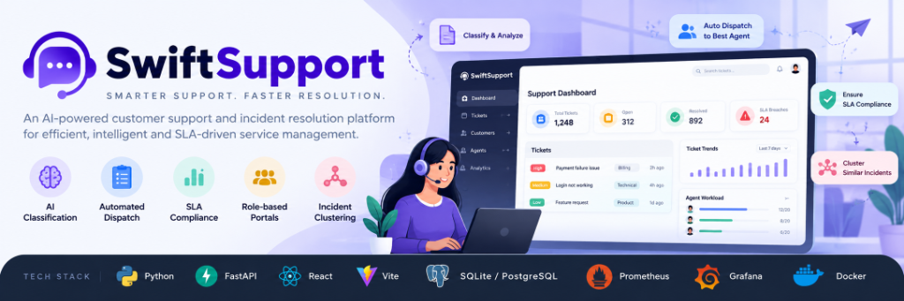

# SwiftSupport

<p align="center">
  
</p>

> **Intelligent Customer Support & Automated Incident Resolution Platform**

SwiftSupport is an enterprise-grade customer support and incident resolution platform designed to eliminate manual triage overhead and streamline ticket lifecycles. Powered by intelligent AI classification, the system automatically analyzes incoming customer inquiries upon submission—categorizing departments, scoring priority, evaluating customer sentiment, and generating concise executive summaries. A built-in automated dispatch engine matches inquiries to active, specialized support agents based on department skillset and real-time workload limits, enforcing strict SLA compliance and enabling incident outage clustering for bulk resolution across dedicated role-based portals for Customers, Agents, and Administrators.

Architecturally, the application is built on a high-performance full-stack ecosystem. The backend is powered by **Python** and **FastAPI**, providing asynchronous RESTful APIs, **JWT-based Role-Based Access Control (RBAC)**, and **SQLAlchemy** with **SQLite/PostgreSQL** for reliable data persistence. The frontend is developed using **React** with **Vite**, featuring modern UI components, responsive layout management, and screenshot attachment lightboxes. For telemetry and operations, the platform integrates **Prometheus** for real-time metric collection (`/metrics`) and custom **Grafana** dashboards containerized via **Docker Compose**, providing deep visibility into ticket velocities, SLA breach rates, and agent capacities.

---

## Table of Contents

- [Overview](#overview)
- [Key Features](#key-features)
- [System Architecture](#system-architecture)
- [Tech Stack](#tech-stack)
- [Getting Started](#getting-started)
  - [Prerequisites](#prerequisites)
  - [Backend Setup](#backend-setup)
  - [Frontend Setup](#frontend-setup)
  - [Demo Accounts](#demo-accounts)
- [Role-Based Portals & Workflows](#role-based-portals--workflows)
  - [Customer Portal](#1-customer-portal)
  - [Agent Command Center](#2-agent-command-center)
  - [Admin Console & Grafana Dashboard](#3-admin-operations-console--grafana-dashboard)
- [Automated Dispatch & Routing Engine](#automated-dispatch--routing-engine)
- [Observability & Metrics](#observability--metrics)
- [API Reference](#api-reference)
- [Project Directory Structure](#project-directory-structure)
- [License](#license)

---

## Overview

Customer support teams face high ticket volumes, manual triage overhead, delayed response times, and inconsistent SLA tracking. SwiftSupport solves these challenges by combining:

1. **Automated AI Triage:** Classifies department, priority, sentiment, and summaries on ticket creation.
2. **Automated Ticket Dispatch:** Instantly assigns tickets to active, available agents based on department skills and real-time workload capacity—zero manual intervention required.
3. **Built-in Grafana & Prometheus Telemetry:** Native observability dashboard displaying ticket velocity, SLA health, department distribution, and agent capacity without requiring external container dependencies.
4. **Rich Multi-Role Experience:** Dedicated interfaces tailored specifically for Customers, Support Agents, and Workspace Administrators.

---

## Key Features

### Intelligent AI Triage & Classification
- **Department Routing:** Categorizes inquiries into Technical, Billing, Sales, Account, or Shipping.
- **Priority & SLA Assignment:** Automatically grades severity (High, Medium, Low) and calculates target deadlines.
- **Sentiment Analysis:** Identifies customer emotion (Positive, Neutral, Negative) to prioritize critical escalations.
- **AI Executive Summary:** Condenses long bug reports and tickets into actionable 1-2 sentence briefs.

### Automated Agent Dispatch Engine
- Evaluates agent online availability (`is_available = 1`).
- Matches the inquiry's department with specialized support staff.
- Balances active queue depth against each agent's maximum concurrency limit (`max_concurrent_tickets`).
- Eliminates manual assignment bottlenecks entirely.

### Screenshot Attachments & Image Lightbox
- Customers can attach PNG, JPG, or WebP error screenshots (up to 5MB) directly during submission.
- Support agents and administrators can inspect high-resolution screenshots with zoom and lightbox viewing.

### Built-in Grafana & Prometheus Observability Dashboard
- Displays all metrics from `customer_support_metrics.json` directly inside the app.
- Multi-bar daily influx vs resolution velocity timeline.
- Interactive SVG donut charts for department load and priority distribution.
- Live Prometheus gauge inspection (`support_tickets_by_status`, `support_tickets_sla_breached`, etc.).
- Raw `/metrics` Prometheus HTTP scrape endpoint.

### Incident Outage Clustering
- Automatically detects related or duplicate tickets during system outages.
- Groups inquiries under a single cluster parent ticket.
- Enables support agents to bulk-resolve hundreds of related tickets with a single unified reply.

### Role-Based Access Control (RBAC) & Fixed Navigation
- Secure JWT authentication with role enforcement (`customer`, `agent`, `admin`).
- Role-gated views: Customers only access submission and tracking; Agents only access their command center and performance analytics; Admins access the console and telemetry.
- Fixed left sidebar navigation with clean SVG vector icon system (zero raw emojis).

---

## System Architecture

```text
                            CUSTOMERS
                                │
                                ▼
                      ┌──────────────────┐
                      │  React Frontend  │ (Vite / React Router)
                      └────────┬─────────┘
                               │
                               ▼
                      ┌──────────────────┐
                      │ FastAPI Backend  │ (Async REST API)
                      └────────┬─────────┘
                               │
            ┌──────────────────┼──────────────────┐
            ▼                  ▼                  ▼
     ┌──────────────┐   ┌──────────────┐   ┌──────────────┐
     │ SQLite / DB  │   │ Local AI Engine│ │  Prometheus  │
     │  (SQLAlchemy)│   │(Classification)│ │  /metrics    │
     └──────────────┘   └──────────────┘   └──────┬───────┘
                                                  │
                                                  ▼
                                           ┌──────────────┐
                                           │   Grafana    │
                                           │  Dashboard   │
                                           │  (In-App UI) │
                                           └──────────────┘
```

---

## Tech Stack

| Domain | Technologies |
| :--- | :--- |
| **Backend** | Python 3.10+, FastAPI, SQLAlchemy, SQLite / PostgreSQL, Pydantic, Passlib, JWT |
| **Frontend** | React 18, Vite, React Router 6, Axios, Pure SVG Visualizations, CSS Modules |
| **Telemetry** | `prometheus-client`, Prometheus HTTP Scrape Endpoint (`/metrics`), Grafana JSON Dashboards |
| **AI Integration** | Local AI Engine / LLM Service with structured JSON output and prompt fallback |
| **Design System** | Clean Lucide-inspired SVG vector components, responsive layouts, fixed-sidebar UX |

---

## Getting Started

### Prerequisites
- **Python 3.10+**
- **Node.js 18+** and **npm**
- *(Optional)* Docker Desktop if running external Prometheus/Grafana containers.

---

### Backend Setup

1. Open a terminal and navigate to the `backend` directory:
   ```bash
   cd backend
   ```

2. Create and activate a Python virtual environment:
   ```bash
   # Windows PowerShell
   python -m venv venv
   .\venv\Scripts\Activate.ps1

   # Linux / macOS
   python3 -m venv venv
   source venv/bin/activate
   ```

3. Install required Python packages:
   ```bash
   pip install -r requirements.txt
   ```

4. Start the FastAPI development server:
   ```bash
   uvicorn app.main:app --reload --port 8000
   ```
   The backend API will be available at `http://localhost:8000`.
   Interactive Swagger documentation is at `http://localhost:8000/docs`.

---

### Frontend Setup

1. Open a second terminal and navigate to the `frontend` directory:
   ```bash
   cd frontend
   ```

2. Install dependencies:
   ```bash
   npm install
   ```

3. Start the Vite development server:
   ```bash
   npm run dev
   ```
   The web application will launch at `http://localhost:5173`.

---

### Demo Accounts

The database comes pre-seeded with accounts ready for instant testing:

| Role | Email | Password | Access Scope |
| :--- | :--- | :--- | :--- |
| **Administrator** | `admin@example.com` | `admin123` | Full Console, Staff Skills, SLA Targets, Grafana Dashboard |
| **Support Agent** | `agent@example.com` | `agent123` | Agent Command Center, Ticket Triage, View Analytics |
| **Customer** | `customer@example.com` | `customer123` | Submit Ticket, Track Tickets & Support Replies |

---

## Role-Based Portals & Workflows

### 1. Customer Portal
- **Submit Ticket (`/`):** Submit support inquiries with name, email, topic, description, and optional screenshot attachment.
- **Track Tickets (`/track`):** Dedicated ticket tracking accessible directly via the sidebar. Enter a ticket ID or browse tracked personal history with live resolution status and direct technical responses.

### 2. Agent Command Center
- **Agent Command Center (`/agent`):** Filter by department, priority, or search keywords. View AI triage summaries, inspect attached customer screenshots in full resolution, compose replies, and mark cases resolved.
- **View Analytics (`/agent/analytics`):** Agent self-performance view displaying personal resolved vs unresolved cases, resolution rate, and interactive SVG pie charts of assigned department categories.

### 3. Admin Operations Console & Grafana Dashboard
- **Admin Console (`/admin`):**
  - **Auto-Dispatched Tickets:** Monitor automated routing decisions and inspect ticket lifecycles in detail.
  - **Agent Availability & Skills:** Manage staff online/offline status, department specialties, and maximum concurrency limits.
  - **SLA Resolution Targets:** Tune target resolution hours for High, Medium, and Low priority tiers.
  - **Accounts & RBAC:** Modify user roles dynamically between Customer, Agent, and Administrator.
  - **Grafana Dashboard Tab:** Embedded view of all observability metrics directly within the console.
- **Dedicated Grafana Dashboard (`/admin/analytics`):** Full-screen telemetry dashboard tracking real-time Prometheus gauges, multi-bar daily influx trends, and staff capacity utilization.

---

## Automated Dispatch & Routing Engine

SwiftSupport features a zero-touch dispatch engine. When a ticket is created:

1. **Immediate Agent Matching:** The system queries staff members where `is_available = 1` matching the ticket's department.
2. **Load Balancing:** Selects the qualified specialist with the lowest active ticket count relative to their concurrency ceiling.
3. **AI Classification Fine-Tuning:** The local AI engine classifies the ticket in the background, updating department tags and ensuring assignment matches the classified domain.

---

## Observability & Metrics

SwiftSupport includes dual observability modes:

### Mode 1: Native In-App Grafana Dashboard (Recommended)
Accessible via the sidebar or Admin Console at `/admin/analytics`. It visualizes all panels defined in the project's Grafana JSON specification without requiring Docker:
- **Total Influx & Resolved Rate:** Real-time counters and percentage trends.
- **Timeline Velocity:** Daily ticket volume over the last 7 days.
- **Department & Priority Distribution:** Interactive donut charts and progression bars.
- **Customer Sentiment Pulse:** Positive, Neutral, Negative breakdown and Net Sentiment Score.
- **Prometheus Raw Gauges Explorer:** Live table showing raw Prometheus gauge values.

### Mode 2: External Dockerized Prometheus & Grafana (Optional)
If Docker Desktop is running, you can launch the standalone observability stack:
```bash
docker-compose up -d prometheus grafana
```
- Prometheus UI: `http://localhost:9090`
- External Grafana UI: `http://localhost:3000` (Default credentials: `admin` / `admin`)
- Raw Scrape Endpoint: `http://localhost:8000/metrics`

---

## API Reference

### Tickets
- `POST /tickets/` - Submit a new support ticket (triggers auto-dispatch & AI classification).
- `GET /tickets/` - List tickets with optional role-based filtering.
- `GET /tickets/{id}` - Retrieve details for a specific ticket.
- `POST /tickets/{id}/reply` - Send an agent reply to the customer and optionally resolve.
- `POST /tickets/{id}/resolve` - Mark ticket status as Resolved.
- `POST /tickets/{id}/auto-assign` - Manually trigger automated agent dispatch.
- `GET /tickets/clusters/active` - List active incident outage clusters.
- `POST /tickets/{id}/resolve-cluster` - Bulk-resolve all tickets grouped under an outage cluster.

### Authentication & Users
- `POST /auth/login` - Authenticate and receive a JWT bearer token.
- `POST /auth/register` - Register a new account.
- `GET /auth/me` - Retrieve profile for the authenticated session.
- `GET /auth/users` - List all workspace users (Staff roster & roles).
- `PUT /auth/users/{id}/role` - Update user authorization level (`customer`, `agent`, `admin`).
- `PUT /auth/users/{id}/profile` - Update staff department, availability, and concurrency limits.

### Administration & Observability
- `GET /settings/analytics` - Aggregated metrics and Prometheus telemetry for the Grafana dashboard.
- `GET /settings/sla` - Retrieve SLA policy thresholds.
- `PUT /settings/sla/{priority}` - Update target resolution hours for a priority tier.
- `GET /metrics` - Prometheus standard scrape endpoint.
- `GET /health/ai` - Real-time AI engine connectivity health check.

---

## Project Directory Structure

```text
customer-support-ai/
├── backend/
│   ├── app/
│   │   ├── ai/               # AI prompts & background classification service
│   │   ├── auth/             # JWT security, password hashing, and role dependencies
│   │   ├── database/         # SQLAlchemy engine, session management, and migrations
│   │   ├── metrics/          # Prometheus metrics & gauge synchronization
│   │   ├── models/           # ORM models (Ticket, User, SLAPolicy)
│   │   ├── routes/           # REST routers (tickets, auth, settings)
│   │   ├── schemas/          # Pydantic request/response schemas
│   │   ├── services/         # Business logic (auto-dispatch, ticket lifecycle)
│   │   └── main.py           # FastAPI application entrypoint & middleware
│   ├── requirements.txt      # Python dependencies
│   └── customer_support.db   # SQLite database instance
├── frontend/
│   ├── src/
│   │   ├── components/       # Reusable components (Icon, AdminSettingsModal)
│   │   ├── context/          # AuthContext and role management
│   │   ├── pages/            # Application pages
│   │   │   ├── CustomerPortal.jsx      # Ticket Submission & Tracking
│   │   │   ├── AgentDashboard.jsx      # Agent Command Center & Triage
│   │   │   ├── AgentAnalyticsPage.jsx  # Agent View Analytics
│   │   │   ├── AdminConsolePage.jsx    # Admin Console & Staff Management
│   │   │   ├── AdminAnalyticsPage.jsx  # Built-in Grafana Dashboard
│   │   │   └── AuthPage.jsx            # Sign In & Sign Up
│   │   ├── services/         # Axios API clients
│   │   ├── App.jsx           # Main layout, fixed sidebar, and routing
│   │   └── index.css         # Global design system & theme variables
│   ├── package.json          # Frontend dependencies
│   └── vite.config.js        # Vite build configuration
├── grafana/                  # Grafana dashboard definitions & provisioning
├── prometheus/               # Prometheus configuration
├── docker-compose.yml        # Docker compose stack for optional containerized services
└── README.md                 # Project documentation
```

---

## License

This project is licensed under the [MIT License](LICENSE).
